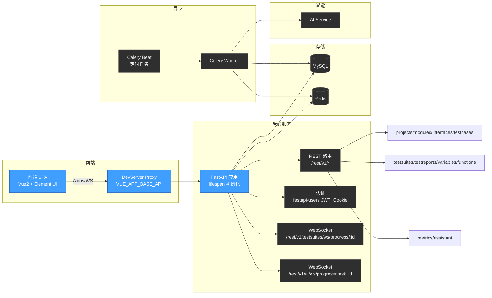

# 接口自动化平台（FastAPI + Vue2 + Element UI）

## 项目简介

企业级接口自动化测试平台，后端基于 FastAPI + SQLAlchemy(Async) + Celery + Redis + MySQL，前端基于 Vue2 + Element UI。支持项目/模块/接口/用例/套件/报告/变量/函数等全流程管理，并集成 AI 测试助手与知识库检索。

## 系统架构图



## 目录结构

```
fastapi_project/
  ├── app/
  │   ├── models/        # ORM模型
  │   ├── routers/       # 路由（projects/modules/.../assistant/metrics）
  │   ├── schemas/       # Pydantic 模型
  │   ├── services/      # 业务服务（含 AI Service）
  │   ├── tasks/         # Celery 异步任务
  │   ├── utils/         # 工具与统一响应
  │   ├── main.py        # FastAPI 入口（lifespan: 创建表/管理员）
  │   ├── config.py      # 配置（数据库/Redis/LLM 等）
  │   └── celery_app.py  # Celery 配置
  └── vue-admin-template/
      ├── src/
      │   ├── api/       # 前端接口封装
      │   ├── views/     # 页面（含 assistant）
      │   ├── components/# 通用组件（MonacoEditor）
      │   ├── utils/     # 工具函数
      │   ├── store/     # Vuex
      │   └── router/    # 路由
      └── vue.config.js  # 开发代理/构建配置
```

## 技术栈

- 后端：FastAPI、SQLAlchemy(Async)、MySQL、Redis、Celery、Pydantic、fastapi-users
- 前端：Vue2、Element UI、Vuex、Vue Router、Axios
- AI：内置 `ai_service`，支持测试用例智能生成与知识库检索

## 启动方式

### 后端

```bash
pip install -r requirements.txt
# 开发
uvicorn app.main:app --reload
# Celery Worker
celery -A app.celery_app.celery_app worker --loglevel=info
# Celery Beat（定时任务）
celery -A app.celery_app.celery_app beat --loglevel=info
# 或者使用 worker 搭配 -B 参数（不建议生产使用）
# celery -A app.celery_app.celery_app worker -B --loglevel=info
```

### 前端

```bash
cd vue-admin-template
npm install
npm run dev
# 生产构建
npm run build:prod
```

## 核心能力

- 项目/模块/接口/用例/套件/报告的统一管理
- 测试套件一键执行、定时任务（Celery）与进度 WebSocket 推送
- 变量与自定义函数，支持参数化与数据提取
- 用户认证（JWT+Cookie）与权限校验
- AI 测试助手：
  - 启动任务：`POST /rest/v1/ai/generate-task/`
  - 任务状态：`GET /rest/v1/ai/task-status/{task_id}/`
  - 导出用例：`GET /rest/v1/ai/export-xlsx/{task_id}/`
  - 进度 WS：`/rest/v1/ai/ws/progress/{task_id}`（Redis Pub/Sub）
  - 知识库查询：`POST /rest/v1/ai/kb/query/`

## 配置说明

- 数据库：`app/config.py` 中 `DATABASE_URL`
- Redis：`REDIS_URL`（用于 Celery 与 WS 进度转发）
- 管理员：首次启动在 `lifespan` 自动创建（默认 `admin@qq.com` / `admin1234`）
- 前端代理：`vue-admin-template/vue.config.js` 中 `VUE_APP_BASE_API` 代理到 `http://localhost:8000`

## 常见问题

- 前端开发警告：Monaco 的动态依赖与 CSS 兼容警告为正常提示，已通过 `stats` 与 `devServer` 降噪。
- WebSocket 进度无消息：确保 Redis 客户端安装并配置正确，Celery 任务运行中。
- 登录失败：确认后端与前端代理地址一致，Cookie/JWT 正常下发。

## 参考

- vue-admin-template
- Element UI
- FastAPI 文档

## License

MIT
