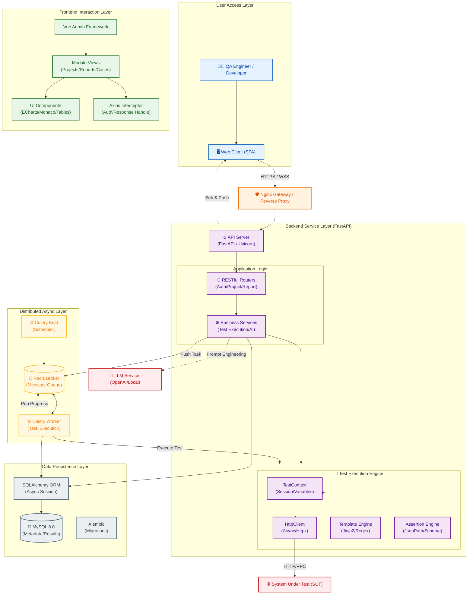

# 🚀 EasyTest - 企业级智能接口自动化测试平台

> **One-Stop Intelligent Interface Automation Testing Platform**
> 
> 基于 **FastAPI** + **Vue2** + **Celery** + **AI** 的现代化测试解决方案。
> 融合了 API 全生命周期管理、分布式异步调度、实时 WebSocket 监控以及 LLM 智能辅助测试，旨在打造高效、稳定、智能的测试工程体系。

---

## 🏗️ System Architecture | 系统架构

采用经典的前后端分离微服务架构，基于 **C4 Model** 的分层设计，确保了系统的高内聚低耦合与水平扩展能力。



---

## ✨ Key Features | 核心特性

### 🛡️ **Robust Testing Infrastructure**
- **全异步内核**：基于 FastAPI + Async SQLAlchemy 构建，轻松应对高并发场景。
- **分布式调度**：Celery + Redis 实现任务队列与定时触发，支持大规模用例并行执行。
- **实时监控**：基于 WebSocket + Redis Pub/Sub 的全链路执行进度实时推送。

### 🧩 **Modular & Flexible Design**
- **模块化管理**：Project -> Module -> Interface -> Case -> Step 多级结构，逻辑清晰。
- **动态上下文**：支持 `${variable}` 语法，实现全局变量、环境变量、前置提取参数的动态替换。
- **高级断言**：内置 JSONPath 提取、正则匹配、Schema 校验等多种断言策略。

### 🤖 **AI-Powered Capabilities**
- **智能用例生成**：基于 LLM 分析接口定义，自动生成覆盖率高的测试用例。
- **自然语言交互**：内置 AI 助手，支持测试知识库问答与 SQL 辅助生成。

---

## 🛠️ Tech Stack | 技术栈

| Layer | Technologies |
|-------|--------------|
| **Backend** | Python 3.9+, FastAPI, SQLAlchemy (Async), Pydantic, Uvicorn |
| **Frontend** | Vue.js 2.x, Element UI, Axios, Vuex, ECharts |
| **Async & Queue** | Celery, Redis (Broker & Backend) |
| **Database** | MySQL 8.0 (Storage), Alembic (Migration) |
| **DevOps** | Docker, Docker Compose, Nginx |

---

## 📂 Directory Structure | 目录结构

```bash
fastapi_project/
├── app/
│   ├── models/        # 🗄️ Database Models (SQLAlchemy)
│   ├── routers/       # 🌐 API Routes (Endpoints)
│   ├── schemas/       # 📝 Pydantic Schemas (Validation)
│   ├── services/      # ⚙️ Business Logic & Services
│   ├── tasks/         # ⚡ Celery Async Tasks
│   ├── utils/         # 🛠️ Utilities (HttpClient, Response)
│   ├── core/          # 🔐 Core Config & Security
│   └── main.py        # 🚀 Application Entry Point
├── vue-admin-template/
│   ├── src/
│   │   ├── api/       # 📡 Frontend API Layer
│   │   ├── views/     # 🖥️ Vue Pages & Views
│   │   ├── components/# 🧩 Reusable Components
│   │   └── store/     # 💾 State Management (Vuex)
│   └── vue.config.js  # 🔧 Build Configuration
├── docker-compose.yml # 🐳 Container Orchestration
└── requirements.txt   # 📦 Python Dependencies
```

---

## 🚀 Quick Start | 快速开始

### Backend Setup

```bash
# 1. Install dependencies
pip install -r requirements.txt

# 2. Run Migrations
alembic upgrade head

# 3. Start API Server
uvicorn app.main:app --reload --host 0.0.0.0 --port 8000

# 4. Start Celery Worker (In separate terminal)
celery -A app.celery_app.celery_app worker --loglevel=info

# 5. Start Celery Beat (Optional, for scheduled tasks)
celery -A app.celery_app.celery_app beat --loglevel=info
```

### Frontend Setup

```bash
cd vue-admin-template

# 1. Install dependencies
npm install

# 2. Start Dev Server
npm run dev
# Access: http://localhost:9528
```

---

## 📄 License

This project is licensed under the **MIT License**.
